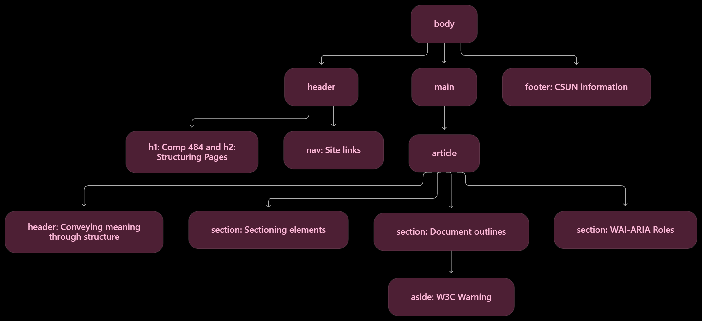
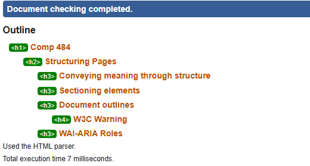

# Homework 2: Structuring Page Content

## Live Website

TODO: Add my GitHub Pages URL after publishing.

## Structuring Strategy

I used structure.html as the model for a consistent structure across all six pages.

- The page header contains the site heading, page heading, and navigation.
- The nav element groups the links to the six pages.
- The main element identifies the main content of each page.
- The article element groups the page's related content into a standalone unit.
- The article header contains introductory content.
- Section elements organize the content by topic.
- In structure.html, the aside contains the W3C Warning because it provides supplementary information related to Document outlines.
- The footer contains the CSUN link and address.
- In syntax.html, div elements group individual doctype examples.

## Heading Outline for structure.html

- h1: Comp 484
  - h2: Structuring Pages
    - h3: Conveying meaning through structure
    - h3: Sectioning elements
    - h3: Document outlines
      - h4: W3C Warning
    - h3: WAI-ARIA Roles

## ARIA Roles

The pages use banner for the page header, navigation for nav, main for the main content, and contentinfo for the footer. The aside in structure.html uses complementary.

These explicit roles follow the supplied course example. The HTML checker reports them as unnecessary because the semantic elements already provide these roles.

## Structure Diagram

## Document Outline

